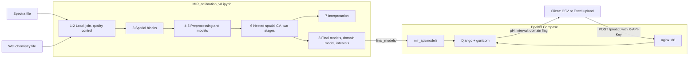

# MIR calibration of soil organic carbon and pH

Mid-infrared (MIR) spectra of Kenyan soils are calibrated against wet-chemistry measurements of **soil organic carbon (SOC)** and **pH (H2O)**. The best models are then served through a Dockerised API.

## Project overview

**Objectives**
1. Develop and validate MIR calibration models for SOC and pH using wet-chemistry reference measurements.
2. Compare statistical and machine-learning algorithms under different spectral preprocessing procedures.

**Data** (Not in this repository)
- Spectra file: 790 samples, one column per wavenumber (about 499 to 3996 cm-1).
- Wet-chemistry file: 121 samples (101 topsoil, 20 subsoil) with SOC, pH and plot coordinates.
- Samples are joined on `layer_id`. The last letter gives depth: `T` = topsoil (0 to 20 cm), `S` = subsoil (20 to 50 cm).
- 669 spectra have no wet chemistry and are predicted in the optional Step 9.

**Method**
- Spectra: bridge the CO2 region (2280 to 2400 cm-1), trim the noisy edge (499 to 600 cm-1), keep every second wavenumber.
- Six preprocessings: raw, SNV, MSC, Savitzky–Golay 1st and 2nd derivative, SNV + 1st derivative.
- Four algorithms: PLS, ridge, SVR, random forest.
- Two-stage comparison: Stage A tests every preprocessing with PLS; Stage B tests all algorithms on the best preprocessing.
- Validation: nested cross-validation with 8 **spatial blocks** (whole neighbourhoods held out), so accuracy reflects genuinely new areas.

**Main results** (spatial-block validation)

| Property | Best model | R² | RMSE | RPD | Verdict |
|---|---|---|---|---|---|
| pH | MSC + ridge | 0.77 | 0.49 | 2.1 | Good |
| SOC | MSC + PLS | -0.02 | 1.41 | 0.99 | No predictive outcome |

pH is predicted well and the result is stable across block layouts. No preprocessing and algorithm combination predicts SOC with this dataset, so the API serves pH only by default.

## Repository structure

```
DSA8401_AML_Github/
├── MIR_calibration_v8.ipynb                 Full analysis script
├── MIR calibration of soil organic carbon and pH.pptx   Presentation slides
├── AI_use.md                                Statement on AI assistance
├── README.md                                This file
└── mir_api/                                 Prediction API (Django + Docker)
    ├── config/                              Django settings, urls, wsgi
    ├── predictor/                           API code: views, services, tests
    ├── models/                              Saved models from the notebook
    ├── Dockerfile
    ├── docker-compose.yml                   API + nginx
    ├── nginx.conf
    ├── requirements.txt
    └── README.md                            API details
```

## Architecture



Request flow inside the API: read the upload, average replicate scans, bridge and align to the model's wavenumber grid, take depth from the last letter of `layer_id`, predict, add the depth-specific interval, and flag spectra outside the calibration domain.

## Setup

**Requirements:** Python 3.13 (match the version you trained with), Jupyter, and for the API, Docker with Docker Compose.

Notebook libraries: `numpy`, `pandas`, `scipy`, `scikit-learn`, `matplotlib`, `joblib`, `openpyxl`, and optionally `pyproj` (the notebook imports it for the coordinate projection in Step 3 and handles its absence).

```bash
git clone <your-repository-url>
cd DSA8401_AML_Github
python -m venv .venv
source .venv/bin/activate            # Windows: .venv\Scripts\activate
pip install numpy pandas scipy scikit-learn matplotlib joblib openpyxl pyproj jupyter
# add any other package the notebook's imports cell reports as missing
```

Record the versions you trained with. The API must use the same ones:

```bash
pip freeze | grep -iE "scikit-learn|numpy|scipy|pandas|joblib"
```

## Steps to reproduce

### 1. Run the analysis
1. Put your spectra and wet-chemistry files in a local folder. The data are private and are not committed.
2. Open `MIR_calibration_v8.ipynb`. In **0.2 Configuration**, set `SPECTRA_PATH` and `WET_CHEMISTRY_PATH`. This is the only cell you should need to edit.
3. Restart the kernel and run all cells (**Restart & Run All**). Finished model runs are cached in `outputs/cv_cache`, so a stopped run can continue.
4. The notebook writes to `outputs/`:
   - `cv_results_spatial_block.csv`: full results grid (Objective 2)
   - `cv_results_by_depth.csv`: results split by topsoil and subsoil
   - `final_models/`: fitted models, metadata, domain model and `mir_pipeline_components.py`
   - `predictions_spectra_without_wet_chemistry.csv`: Step 9 predictions

Results use fixed random seeds, so a rerun on the same data should give the same numbers, apart from small differences caused by library versions.

### 2. Build and run the API
1. Copy the contents of `outputs/final_models/` into `mir_api/models/`:
   ```bash
   cp outputs/final_models/* mir_api/models/
   ```
2. Make `mir_api/requirements.txt` match the versions from `pip freeze` above.
3. Create the environment file:
   ```bash
   cd mir_api
   cp .env.example .env
   # edit .env: DJANGO_SECRET_KEY, API_KEY, DJANGO_ALLOWED_HOSTS
   ```
4. Start the services:
   ```bash
   docker compose up --build -d
   curl http://localhost/health
   ```
5. Send a spectra file (needs a `layer_id` column and one numeric column per wavenumber):
   ```bash
   curl -H "X-API-Key: $API_KEY" -F "file=@spectra.csv" http://localhost/predict
   ```

### 3. Run the API tests
```bash
cd mir_api
MODEL_DIR=./models ENABLED_TARGETS=ph_h2o python manage.py test
```
The tests compare API output with the saved model's own predictions and check that bad input is rejected. They are skipped if no models are present.

## API summary

| Method | Path | Purpose |
|---|---|---|
| GET | `/health` | Loads the models, used by the Docker health check |
| GET | `/models` | Recipe, validated accuracy and interval widths per model |
| POST | `/predict` | Upload `file` (.csv or .xlsx), returns predictions with intervals and a domain flag |

Each result carries `reliability`: `ok`, or `do_not_use` when the spectrum lies outside the calibration domain. More detail is in `mir_api/README.md`.

## Limitations

- Only 121 calibration samples, and 20 subsoil samples, so subsoil accuracy is uncertain.
- SOC is not predicted by any combination. SOC is off in the API (`ENABLED_TARGETS=ph_h2o`). If you enable it, `/models` shows a warning.
- Choosing the preprocessing on the same folds adds a small optimistic bias.
- pH predictions beyond the calibration range (4.31 to 8.74) are extrapolation.
- The domain check shows that a spectrum resembles the calibration spectra, not that its prediction is accurate.

## Data and privacy

The spectra and wet-chemistry data are private and must not be committed. Keep them, `outputs/` and `.env` out of version control (see `.gitignore`).

## Author

Phanuel Ayuka, ADM No. 224078.
